# Manual do Sistema de Protocolo Interno

Guia de uso do **Sistema de Protocolo Interno** — gestão de protocolos, proposições e sessões legislativas para Câmaras Municipais.

Este manual é destinado a **todos os usuários** do sistema (vereadores, protocolo, secretaria e administração). Ele explica o que cada módulo faz, o que cada perfil pode acessar e como realizar as tarefas do dia a dia — inclusive como cadastrar um usuário e vinculá-lo a um perfil.

---

## Sumário

1. [Visão geral](#1-visão-geral)
2. [Primeiro acesso](#2-primeiro-acesso)
3. [Conhecendo a tela](#3-conhecendo-a-tela)
4. [Perfis de acesso: o que cada um pode fazer](#4-perfis-de-acesso-o-que-cada-um-pode-fazer)
5. [Como cadastrar um usuário](#5-como-cadastrar-um-usuário)
6. [Como vincular um usuário a um perfil, setor e vereador](#6-como-vincular-um-usuário-a-um-perfil-setor-e-vereador)
7. [Gestão de usuários: editar, bloquear e excluir](#7-gestão-de-usuários-editar-bloquear-e-excluir)
8. [Módulo Protocolos](#8-módulo-protocolos)
9. [Caixa de Entrada](#9-caixa-de-entrada)
10. [Módulo Proposições](#10-módulo-proposições)
11. [Módulo Comissões](#11-módulo-comissões)
12. [Módulo Sessões e Votações](#12-módulo-sessões-e-votações)
13. [Módulos de apoio](#13-módulos-de-apoio)
14. [Painel do Vereador](#14-painel-do-vereador)
15. [Perguntas frequentes](#15-perguntas-frequentes)

---

## 1. Visão geral

O sistema organiza todo o ciclo documental e legislativo de uma Câmara:

- **Protocolos** — entrada, tramitação, recebimento e acompanhamento de documentos entre setores e comissões.
- **Proposições** — projetos de lei, requerimentos, indicações, vetos e demais matérias legislativas (de origem **Legislativa** ou **Executiva**), com encaminhamento a comissões, pareceres, inclusão em pauta e votação.
- **Sessões** — pauta do dia, documentos e registro de votações.
- **Comissões** — criação, composição e atuação dos membros.
- **Administração** — usuários, perfis, setores, vereadores, relatórios, auditoria e backup.

O sistema é **multi-Câmara**: cada Câmara vê apenas os seus próprios dados. Um usuário de uma Câmara nunca enxerga informações de outra.

---

## 2. Primeiro acesso

1. Abra o endereço do sistema no navegador (ex.: `https://suacamera.com.br`).
2. Informe **e-mail** e **senha** e clique em **Entrar**.
3. Marque **Lembrar-me neste dispositivo** se quiser permanecer conectado.

> **Esqueceu a senha?** Peça ao administrador da sua Câmara para redefini-la no cadastro do usuário.

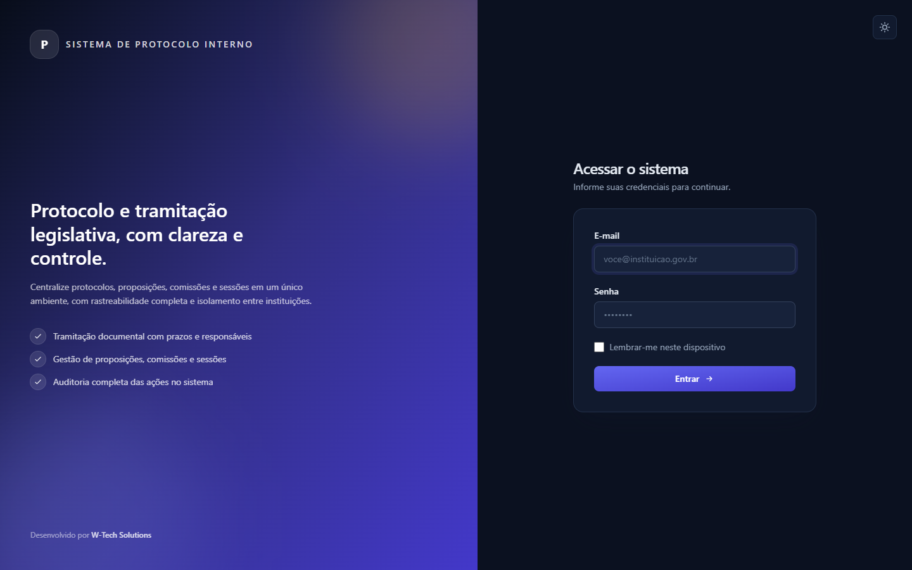

*Tela de login.*

### Dados da sua conta

No menu do usuário (canto superior direito) está a opção **Meu perfil**, onde você pode:

- Atualizar **nome** e **e-mail**;
- Alterar a **senha**.

### Tema claro / escuro

Na barra superior há o botão de alternância entre **tema claro** e **tema escuro**. A preferência fica salva no seu navegador e é mantida nos próximos acessos.

### Bloqueio de acesso

Usuários podem ser **bloqueados** pelo administrador. Um usuário bloqueado não consegue entrar no sistema, mas seus registros e histórico permanecem intactos.

---

## 3. Conhecendo a tela

A tela é dividida em três áreas:

- **Barra superior** — título da página, alternância de tema e menu do usuário.
- **Menu lateral (esquerda)** — navegação entre os módulos.
- **Área de conteúdo** — a página do módulo selecionado.

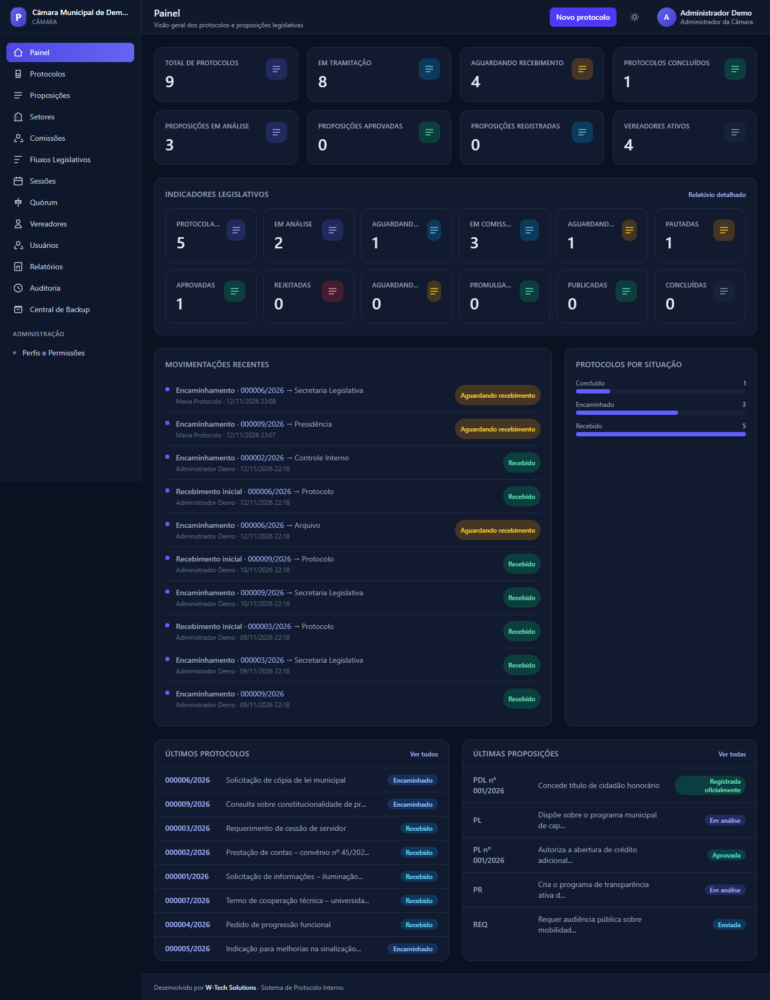

*Painel principal, com o menu lateral à esquerda.*

O menu lateral mostra **apenas os módulos que o seu perfil pode acessar**. Se você não vê "Usuários", por exemplo, é porque o seu perfil não tem essa permissão.

Itens do menu:

| Item | Descrição |
|---|---|
| **Painel** | Resumo geral com atalhos e indicadores. |
| **Protocolos** | Lista e gestão de protocolos. |
| **Proposições** | Lista e gestão de matérias legislativas. |
| **Setores** | Setores internos da Câmara. |
| **Comissões** | Comissões permanentes e temporárias. |
| **Minhas Comissões** | *(aparece só para quem integra alguma comissão)* Suas comissões e pendências. |
| **Fluxos Legislativos** | Modelos de tramitação de proposições. |
| **Sessões** | Sessões legislativas, pauta e votações. |
| **Quórum** | Regras de quórum por tipo de votação. |
| **Vereadores** | Cadastro de parlamentares. |
| **Usuários** | Cadastro de usuários do sistema. |
| **Relatórios** | Relatórios de protocolos e proposições. |
| **Auditoria** | Histórico de ações realizadas no sistema. |
| **Central de Backup** | Geração e restauração de cópias de segurança. |
| **Administração** | *Câmaras* e *Perfis e Permissões* (apenas administração). |

No rodapé do menu aparece o botão **Painel do Vereador** para quem tem vínculo com um vereador.

---

## 4. Perfis de acesso: o que cada um pode fazer

Cada usuário recebe **um perfil**, que define tudo o que ele pode fazer. O sistema vem com os seguintes perfis:

| Perfil | Para quem é | O que pode fazer |
|---|---|---|
| **Super Admin** | Equipe da plataforma (W-Tech) | Acesso total, incluindo gestão de todas as Câmaras. Não pertence a uma Câmara específica. |
| **Administrador da Câmara** | Responsável pela TI/administração da Câmara | Tudo dentro da sua Câmara: usuários, setores, vereadores, comissões, protocolos, proposições, sessões, relatórios, auditoria e backup. |
| **Secretaria / Diretoria** | Diretoria e chefias | Gestão completa do fluxo documental e legislativo, exceto cadastro de usuários e backup. Pode criar/editar/receber/encaminhar protocolos, tratar proposições e emitir pareceres. |
| **Secretaria Legislativa** | Equipe da secretaria da Mesa | Composição de comissões, sessões, votações, registro e análise de proposições, relatórios e pareceres. |
| **Recepção / Protocolo** | Balcão de protocolo | Cadastrar protocolos, encaminhar, receber e despachar para comissões. Não exclui nem conclui protocolos. |
| **Servidor de Setor** | Servidores dos setores internos | Receber, encaminhar e concluir protocolos do seu setor, além de registrar providências. |
| **Presidente** | Presidente da Câmara | Visão legislativa ampla: sessões, votações, comissões, proposições, pareceres, relatórios e auditoria. |
| **Vereador** | Parlamentares | Consultar protocolos e proposições, criar proposições e acompanhar comissões, sessões e votações. |
| **Membro de Comissão** | *(não é um perfil, é um vínculo)* | Qualquer usuário vinculado a um vereador que integre uma comissão ativa ganha automaticamente a atuação naquela comissão — ver [seção 11](#11-módulo-comissões). |

> **Importante:** o que aparece no menu depende do perfil. Se faltar uma permissão, o item simplesmente não é exibido — e a tentativa de acessar direto pela URL é bloqueada.

### Acesso dentro das comissões

Além do perfil, existe uma regra especial para **comissões**:

- **Qualquer membro ativo** de uma comissão pode **receber** e **encaminhar** documentos daquela comissão.
- Apenas **Presidente** e **Relator** da comissão podem **registrar parecer**.
- Os papéis dentro da comissão são: **Presidente**, **Vice-presidente**, **Secretário**, **Membro** e **Relator**.

Assim, um vereador consegue trabalhar nos documentos da própria comissão **sem** precisar de permissões administrativas globais.

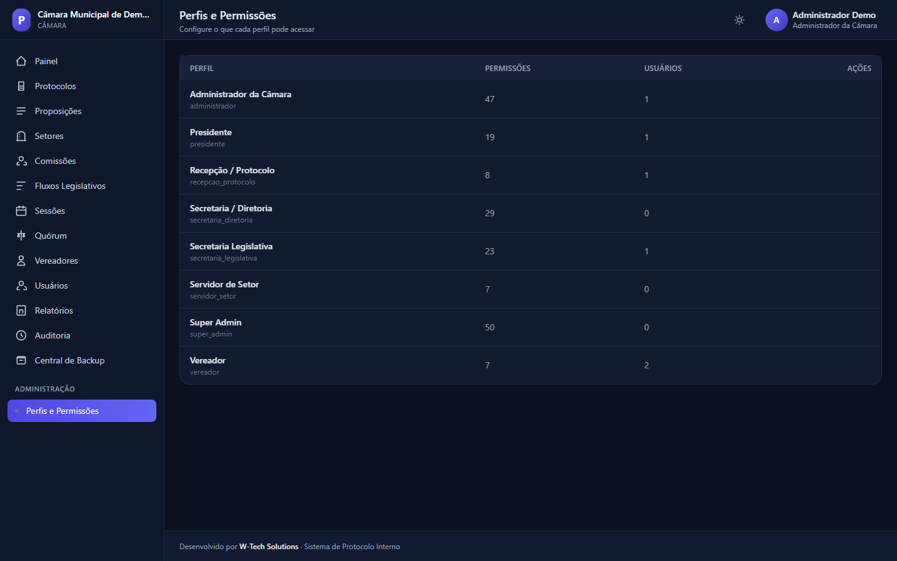

*Tela de Perfis e Permissões (menu Administração), onde o administrador consulta o que cada perfil acessa.*

---

## 5. Como cadastrar um usuário

> Requer o perfil **Administrador da Câmara** (ou Super Admin).

1. No menu lateral, clique em **Usuários**.
2. Clique no botão **Novo usuário**.
3. Preencha o formulário:

| Campo | Obrigatório | Descrição |
|---|---|---|
| **Nome** | Sim | Nome completo do usuário. |
| **E-mail** | Sim | Será o login do usuário. Deve ser único no sistema. |
| **Telefone** | Não | Contato. |
| **CPF/CNPJ** | Não | Documento do usuário. |
| **Perfil** | Sim | Define as permissões (ver [seção 4](#4-perfis-de-acesso-o-que-cada-um-pode-fazer)). |
| **Setor** | Não | Setor onde o usuário trabalha (ver [seção 6](#6-como-vincular-um-usuário-a-um-perfil-setor-e-vereador)). |
| **Vereador vinculado** | Não | Só para servidores que também respondem por um vereador (ex.: Presidente). |
| **Câmara** | Só para Super Admin | Câmara à qual o usuário pertencerá. |
| **Senha** / **Confirmar senha** | Sim | Mínimo de **8 caracteres**. |
| **Usuário ativo** | Não | Se desmarcado, o usuário é criado bloqueado. |

4. Clique em **Salvar**.

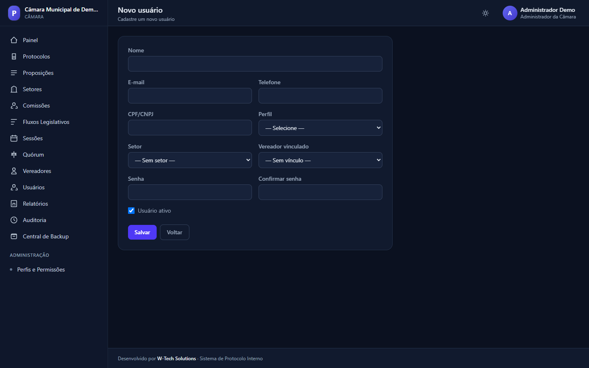

*Formulário de cadastro/edição de usuário — é aqui que se define o perfil, o setor e o vereador vinculado.*

O usuário aparecerá na lista e já poderá entrar com o e-mail e a senha definidos.

> **Dica:** ao criar um usuário, informe uma senha inicial e oriente-o a trocá-la no primeiro acesso (menu **Meu perfil**).

### Lista de usuários

Na tela **Usuários** você pode:

- **Buscar** por nome ou e-mail;
- **Filtrar** por perfil;
- Ver **nome, e-mail, perfil, setor e situação** (Ativo / Bloqueado).

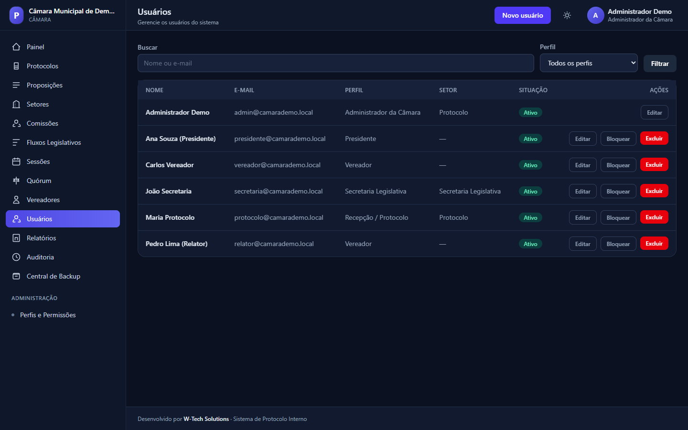

*Lista de usuários, com busca por nome/e-mail e filtro por perfil.*

---

## 6. Como vincular um usuário a um perfil, setor e vereador

Tudo isso é feito no **mesmo formulário** de cadastro/edição do usuário.

### 6.1 Vincular a um perfil (obrigatório)

O campo **Perfil** define o que o usuário pode fazer. Sempre escolha o perfil que corresponde à função real da pessoa. Se a função mudar, basta editar o usuário e trocar o perfil.

### 6.2 Vincular a um setor (opcional)

O campo **Setor** indica onde o usuário trabalha. Ele é usado, por exemplo, para a **Caixa de Entrada**: o sistema mostra as movimentações destinadas ao setor do usuário.

- Deixe **Sem setor** para usuários que não trabalham em um setor específico (ex.: vereadores e administração).

### 6.3 Vincular a um vereador (opcional)

O campo **Vereador vinculado** liga o usuário a um vereador cadastrado no módulo **Vereadores**.

Quando esse vínculo existe, o usuário passa a:

- Ver o botão **Painel do Vereador**;
- Enxergar as **proposições daquele vereador**;
- Atuar nas **comissões** em que o vereador é membro ativo.

Esse vínculo é usado principalmente para:

- **Vereadores** que acessam o sistema;
- **Presidente da Câmara** ou outros cargos que também respondem por um vereador.

> **Vínculo único (1 para 1):** cada usuário responde por **no máximo um** vereador e cada vereador é respondido por **no máximo um** usuário. Se você vincular um vereador que já estava ligado a outro usuário, o vínculo anterior é substituído automaticamente — nos dois sentidos. Registros antigos não ficam "duplicados".

### 6.4 Vincular a uma Câmara (Super Admin)

O Super Admin escolhe em qual **Câmara** o usuário será criado. Administradores de Câmara não veem esse campo: os usuários que eles criam já nascem na própria Câmara.

---

## 7. Gestão de usuários: editar, bloquear e excluir

Na lista de **Usuários**, em cada linha:

- **Editar** — abre o mesmo formulário para atualizar dados, perfil, setor ou vínculo.
  - Ao editar, deixe os campos **Senha** e **Confirmar senha** em branco para **manter a senha atual**.
- **Bloquear / Desbloquear** — alterna o acesso do usuário sem apagar nada.
- **Excluir** — remove o usuário do sistema.

> **Você não pode** bloquear ou excluir a si próprio — o sistema impede.

Todas essas ações são registradas na **Auditoria** (quem fez, quando e o quê).

---

## 8. Módulo Protocolos

O protocolo representa um documento que entra na Câmara e circula entre setores e comissões.

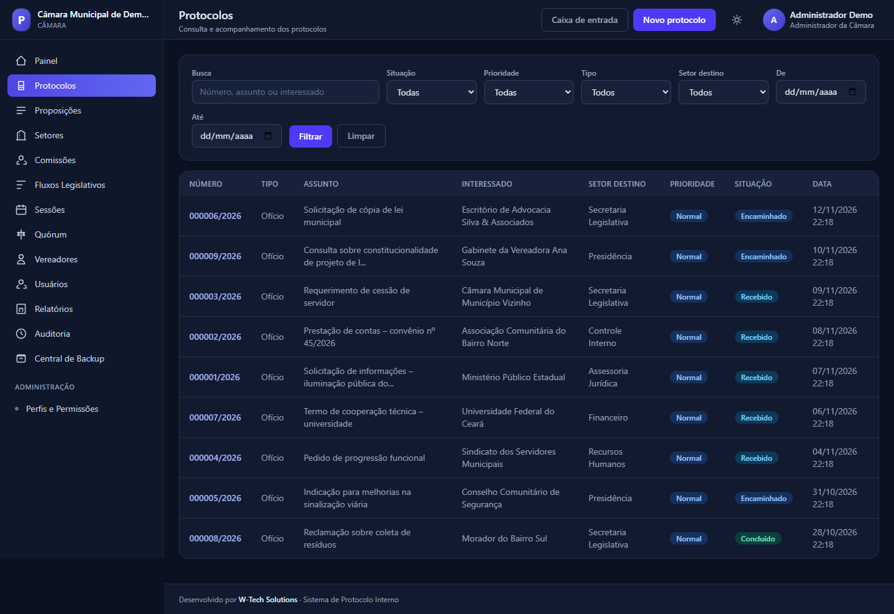

*Lista de protocolos, com filtros por situação, setor e prazo.*

### Criar um protocolo

1. Menu **Protocolos** → **Novo**.
2. Preencha os dados do documento (interessado, assunto, tipo, prioridade, prazo etc.).
3. Anexe os arquivos, se houver.
4. Salve. O sistema gera o **número do protocolo** automaticamente.

### Encaminhar (tramitar)

1. Abra o protocolo.
2. Use **Encaminhar** e escolha o **destino**: um **setor** ou uma **comissão**.
3. Informe o prazo, se aplicável. O destino passa a aparecer na **Caixa de Entrada** dele.

### Receber, recusar ou receber com ressalva

Ao receber um documento, o responsável tem três opções:

| Ação | Efeito |
|---|---|
| **Receber** | Confirma o recebimento; a responsabilidade passa para o destinatário. |
| **Recusar** | Devolve a responsabilidade; exige **motivo** (a recusa fica registrada). |
| **Receber com divergência** | Aceita o recebimento, mas abre uma **ocorrência** (ex.: documento diferente do informado). |

> **Recusar** não transfere a responsabilidade. **Receber com divergência** transfere e abre a ocorrência ao mesmo tempo — as duas operações acontecem juntas, sem meio-termo.

### Providências

Enquanto o documento está sob sua responsabilidade, você pode registrar **providências** (as medidas tomadas: despachos, comunicações, etc.). Uma providência pode ou não estar ligada a uma movimentação.

### Ocorrências (divergências)

Uma **ocorrência** registra um problema na tramitação. Ela é resolvida ou encerrada — e o encerramento **sem resolução exige justificativa**.

> Registrar uma ocorrência **não muda** a responsabilidade atual nem cria uma nova tramitação.

### Retificação de movimentação

Erros no encaminhamento podem ser **retificados** (corrigidos) sem apagar o registro original — o sistema mantém a movimentação antiga e adiciona a correção, para fins de auditoria.

- Retificar **não** permite alterar autoria, datas originais, recusas ou ocorrências.
- Mudar o **destino** de uma movimentação exige uma permissão especial (**retificar destino**).

### Comprovante e espelho

- **Comprovante** — documento de confirmação da tramitação/protocolo.
- **Espelho** — visão consolidada de todo o histórico do protocolo.

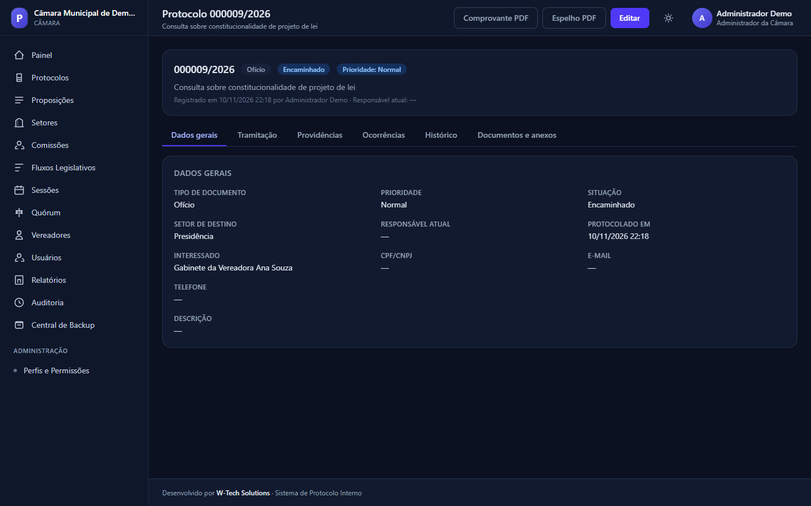

*Detalhe do protocolo: dados, tramitação, providências, ocorrências e anexos.*

---

## 9. Caixa de Entrada

A **Caixa de Entrada** reúne tudo o que está pendente com o seu setor ou com as suas comissões. Ela é acessada em **Protocolos → Caixa de Entrada**.

Ela possui **7 filtros**:

| Filtro | O que mostra |
|---|---|
| **Aguardando recebimento** | Documentos enviados a você e ainda não recebidos. |
| **Recebidos** | Documentos já recebidos por você. |
| **Recusados** | Documentos que você recusou. |
| **Divergência aberta** | Itens com ocorrência em aberto. |
| **Providência pendente** | Itens que aguardam uma providência sua. |
| **Próximos do vencimento** | Com prazo se aproximando. |
| **Prazo vencido** | Com prazo já estourado. |

Cada filtro mostra a quantidade de itens, para você priorizar o que é urgente.

> A Caixa de Entrada mostra apenas o que pertence ao **seu setor** e às **suas comissões** — nunca pendências de outra pessoa.

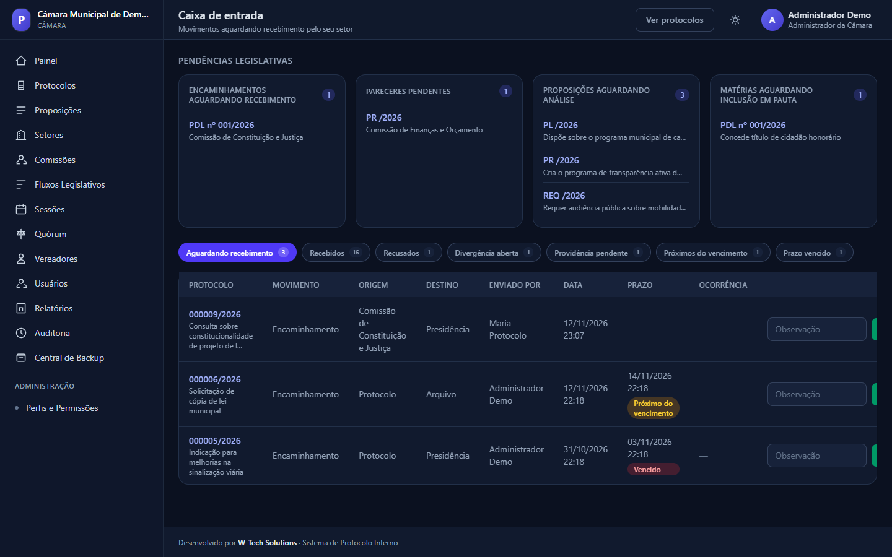

*Caixa de Entrada com as abas de filtro e os contadores de cada categoria.*

---

## 10. Módulo Proposições

Proposições são as matérias legislativas (projetos de lei, requerimentos, indicações, **vetos** etc.), que podem ter origem no **próprio Legislativo** ou vir do **Poder Executivo**.

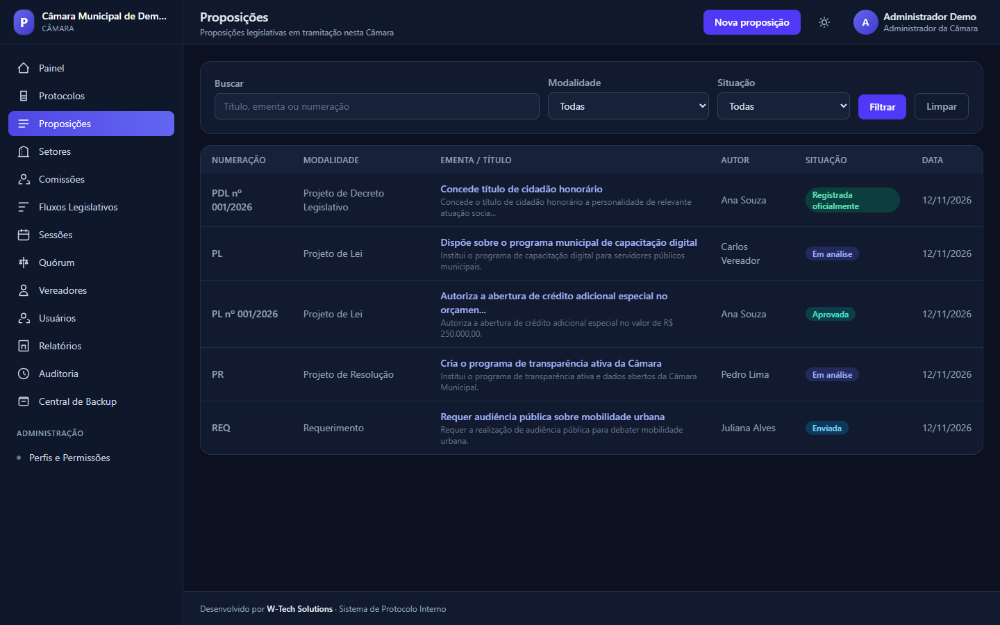

*Lista de proposições, com filtros por tipo, situação e autoria. Matérias de origem externa exibem uma etiqueta ao lado da modalidade.*

### Criar uma proposição

1. Menu **Proposições** → **Nova**.
2. Escolha a **Modalidade** (Projeto de Lei, Veto, Requerimento, Indicação etc.).
3. Escolha a **Origem** (ver abaixo).
4. Informe a **autoria** — o formulário se adapta à origem escolhida:
   - Origem **Poder Legislativo** → selecione o **vereador autor** (e os coautores, se houver).
   - Origem **Poder Executivo** ou **Outros** → informe o **autor externo** (nome ou cargo). O campo de vereador é ocultado automaticamente.
5. Preencha título, ementa e anexe documentos; salve.

### Origem da proposição: Legislativo x Executivo

O campo **Origem** indica de onde veio a matéria e define como a autoria é registrada:

- **Poder Legislativo** — matéria de autoria de **vereadores**. O autor principal é obrigatoriamente um vereador da Câmara.
- **Poder Executivo** — matérias enviadas pelo **Prefeito**: projetos de lei, **vetos** e mensagens. A autoria é registrada como **autor externo** (nome/cargo), sem exigir um vereador.
- **Outros** — demais origens externas (ex.: Tribunal de Contas, entidades da sociedade civil), também com autor externo.

> **Atenção:** **ofícios e demais comunicações** do Executivo que **não** são matérias legislativas (não tramitam nem são votadas) devem ser registrados no módulo **[Protocolos](#8-módulo-protocolos)**, como documento do tipo **Ofício** — e não como proposição.

### Modalidade Veto

O **Veto** é uma modalidade de proposição, normalmente de **origem Executivo** (veto do Prefeito a um projeto aprovado). Ele percorre o mesmo fluxo das demais matérias — encaminhamento a comissões, parecer, inclusão em **pauta** e **votação em Plenário** — e recebe numeração oficial própria (**VET nº 001/ano**).

### Fluxo básico

1. **Criar** a proposição.
2. **Enviar** (protocolizar) — a matéria entra no fluxo.
3. **Analisar** (triagem/revisão) pela secretaria.
4. **Registrar** — a proposição recebe número oficial e passa a tramitar.

### As 7 abas da proposição

Ao abrir uma proposição, os dados são organizados em:

1. **Dados gerais** — tipo, número, ementa, autores, situação.
2. **Tramitação** — o passo a passo do processo.
3. **Comissões** — encaminhamentos e **pareceres** das comissões.
4. **Sessões** — em quais sessões a matéria foi pautada.
5. **Votações** — resultados das votações.
6. **Documentos** — anexos.
7. **Histórico** — linha do tempo com tudo o que aconteceu.

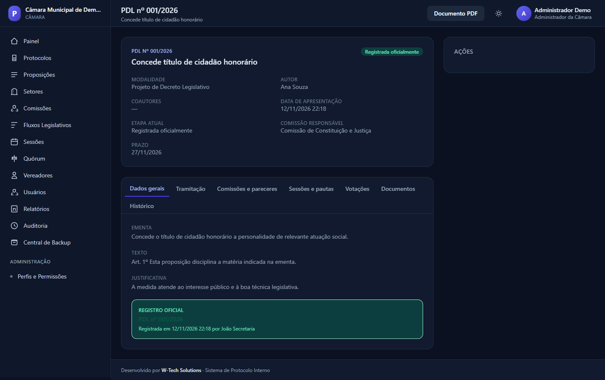

*Detalhe da proposição, organizado nas 7 abas.*

### Encaminhamento a comissões e parecer

1. Na aba **Comissões**, encaminhe a proposição para uma ou mais comissões.
2. A comissão **recebe**, analisa e emite **parecer** (favorável / contrário / etc.) com prazo.

> **Atenção:** o parecer é **consultivo**. Ele **não** muda automaticamente a situação da proposição para "Aprovada" — isso só acontece por **voto em Plenário**.

### Enviar para a pauta e votar

A proposição aprovada nas comissões é incluída na **pauta de uma sessão** e, depois, submetida a **votação**.

---

## 11. Módulo Comissões

### Criar uma comissão

**Comissões** → **Nova**: informe nome, sigla e tipo (permanente/temporária).

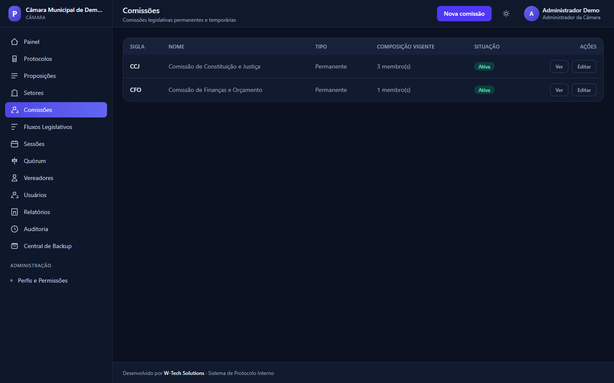

*Lista de comissões da Câmara.*

### Composição da comissão

Na tela da comissão, em **integrantes**, adicione os **vereadores** com seus papéis e períodos:

- **Presidente** e **Vice-presidente** são **cargos únicos**: adicionar um novo titular **encerra automaticamente** o mandato anterior.
- **Secretário** pode ter **mais de um** titular.
- **Membro** e **Relator** completam a composição.

> A composição vincula **vereadores**, não usuários. O acesso do usuário à comissão acontece pelo vínculo dele com o vereador (ver [seção 6.3](#63-vincular-a-um-vereador-opcional)).
>
> Remover um integrante exige **justificativa**, que fica registrada na auditoria.

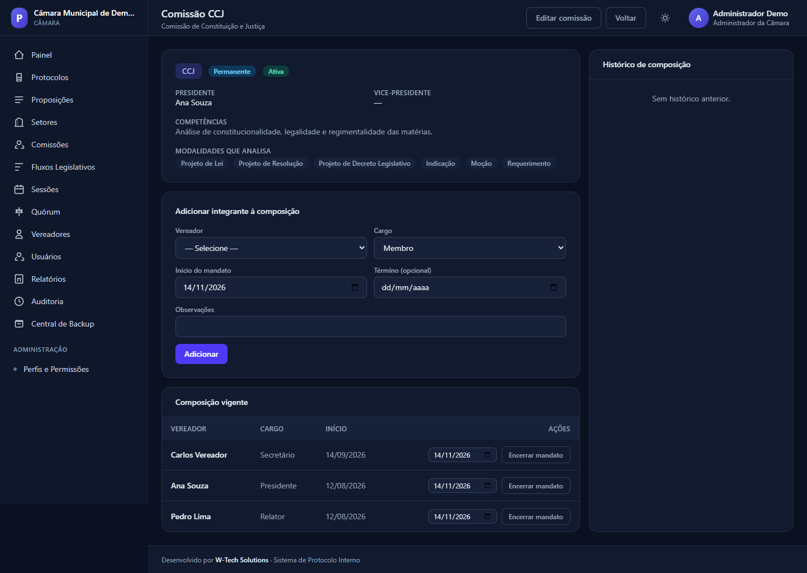

*Detalhe da comissão: composição com papéis e períodos de cada integrante.*

### Minhas Comissões

Quem integra alguma comissão ativa vê o item **Minhas Comissões** no menu, com:

- As **comissões** em que atua e o **seu papel** em cada uma;
- As **pendências de parecer e recebimento** sob sua responsabilidade.

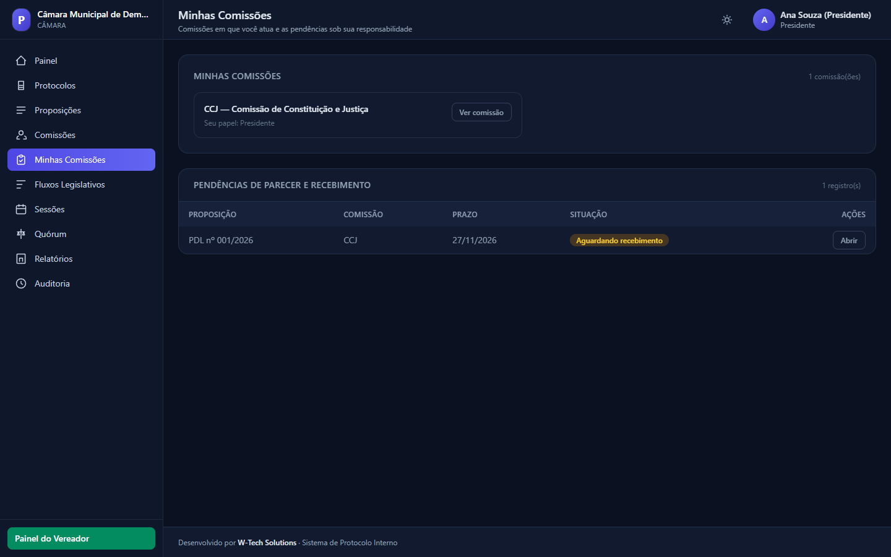

*Minhas Comissões vista por um **Presidente** de comissão (Ana Souza) — com permissão para registrar parecer.*

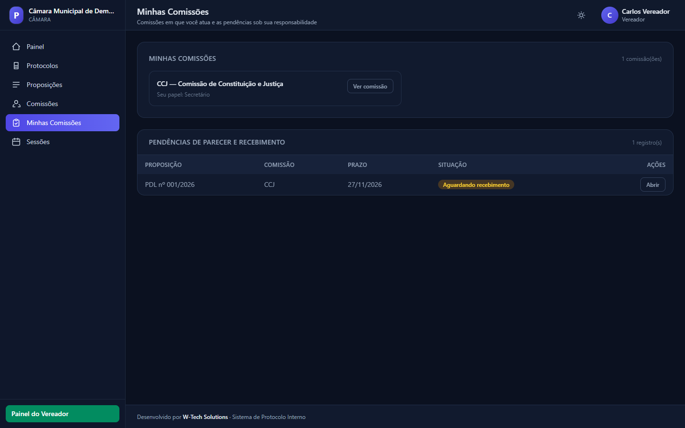

*A mesma tela vista por um **Secretário** de comissão — recebe e encaminha, mas não registra parecer.*

### Atuação dentro da comissão

| Papel | Receber/encaminhar | Registrar parecer |
|---|---|---|
| Presidente | Sim | Sim |
| Relator | Sim | Sim |
| Vice-presidente | Sim | Não |
| Secretário | Sim | Não |
| Membro | Sim | Não |

---

## 12. Módulo Sessões e Votações

### Sessões

**Sessões** → **Criar**: informe número, tipo, data/hora e o **presidente da sessão**.

- O número não pode se repetir no mesmo ano na mesma Câmara.
- Na sessão, você monta a **pauta** incluindo proposições.

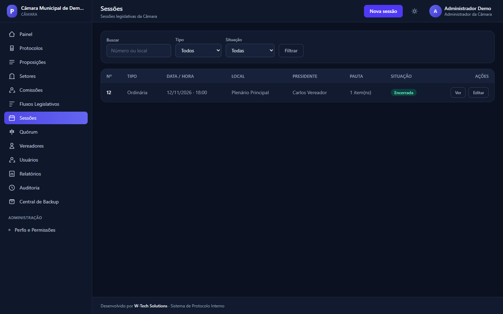

*Lista de sessões legislativas.*

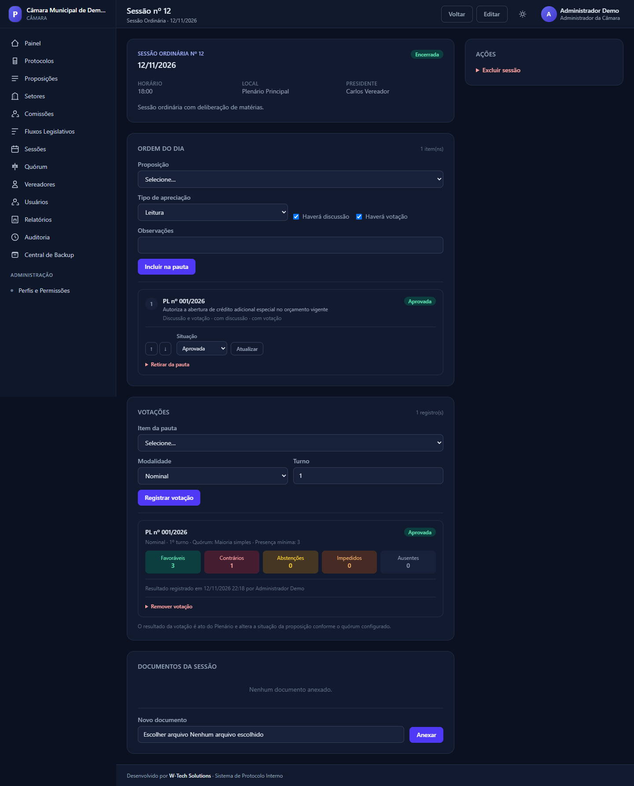

*Detalhe da sessão: pauta do dia, documentos e votações.*

### Pauta

- Reordene os itens, **retire** um item com **justificativa** e o sistema **reindexa** as posições automaticamente.
- Cada proposição aparece apenas uma vez por sessão.

### Documentos da sessão

Anexe atas e outros documentos diretamente à sessão.

### Votações

1. Abra a sessão e crie a **votação** (tipo, quórum, proposição).
2. Registre os **votos** individualmente.
3. Finalize para apurar o **resultado**.

- Remover um voto individual exige **justificativa** (fica na auditoria).
- Após a votação, registre as **ações pós-votação** (encaminhamentos decorrentes).

### Quórum

O módulo **Quórum** define a regra de maioria por **tipo de votação** (maioria simples, absoluta, dois terços etc.), usada automaticamente na apuração.

---

## 13. Módulos de apoio

### Setores

Cadastro dos setores internos (Protocolo, Secretaria Legislativa, Presidência, Assessoria Jurídica etc.). O setor do usuário direciona a **Caixa de Entrada**.

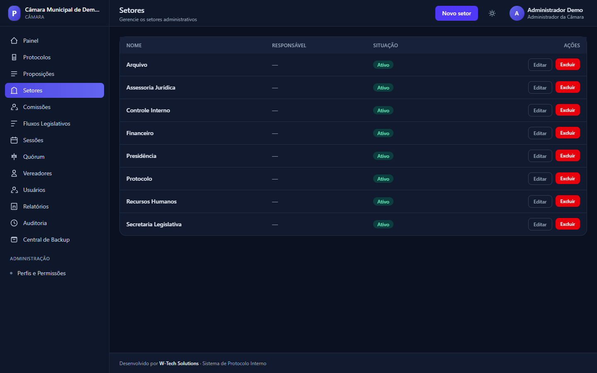

*Cadastro de setores.*

### Vereadores

Cadastro dos parlamentares (nome, partido, legislatura, contato). É a base para a **composição de comissões** e para o **vínculo com usuários**.

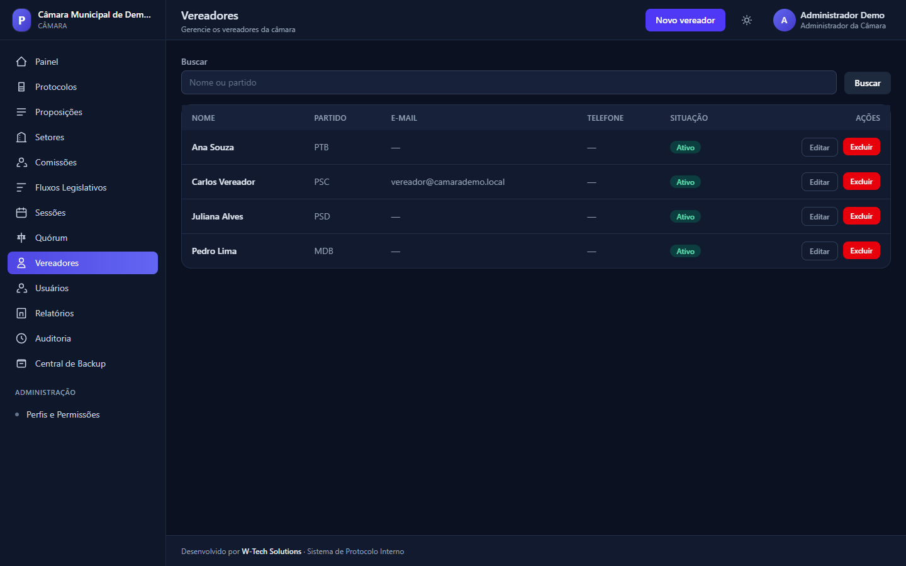

*Cadastro de vereadores.*

### Fluxos Legislativos

Modelos que descrevem as **etapas de tramitação** de cada tipo de proposição.

- Cada fluxo tem **versões**.
- Uma versão **publicada é imutável**: para alterar, cria-se uma **nova versão**, sem afetar a publicada.

### Relatórios

Relatórios de **protocolos** e **proposições**, com filtros por período, setor/comissão, tipo e situação.

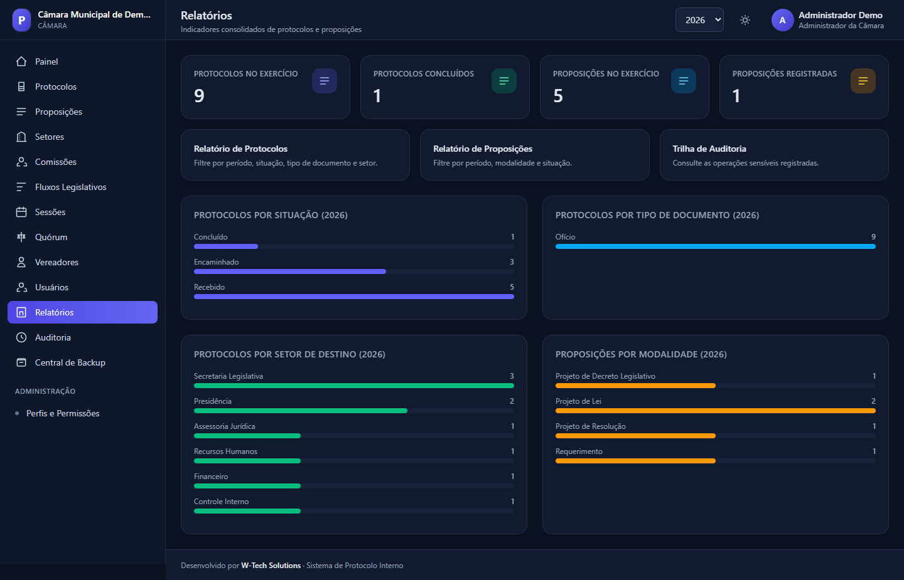

*Central de relatórios.*

### Auditoria

Registro de **todas as ações** relevantes do sistema (criações, alterações, exclusões, recebimentos, recusas, retificações, logins etc.), com autor, data e detalhes.

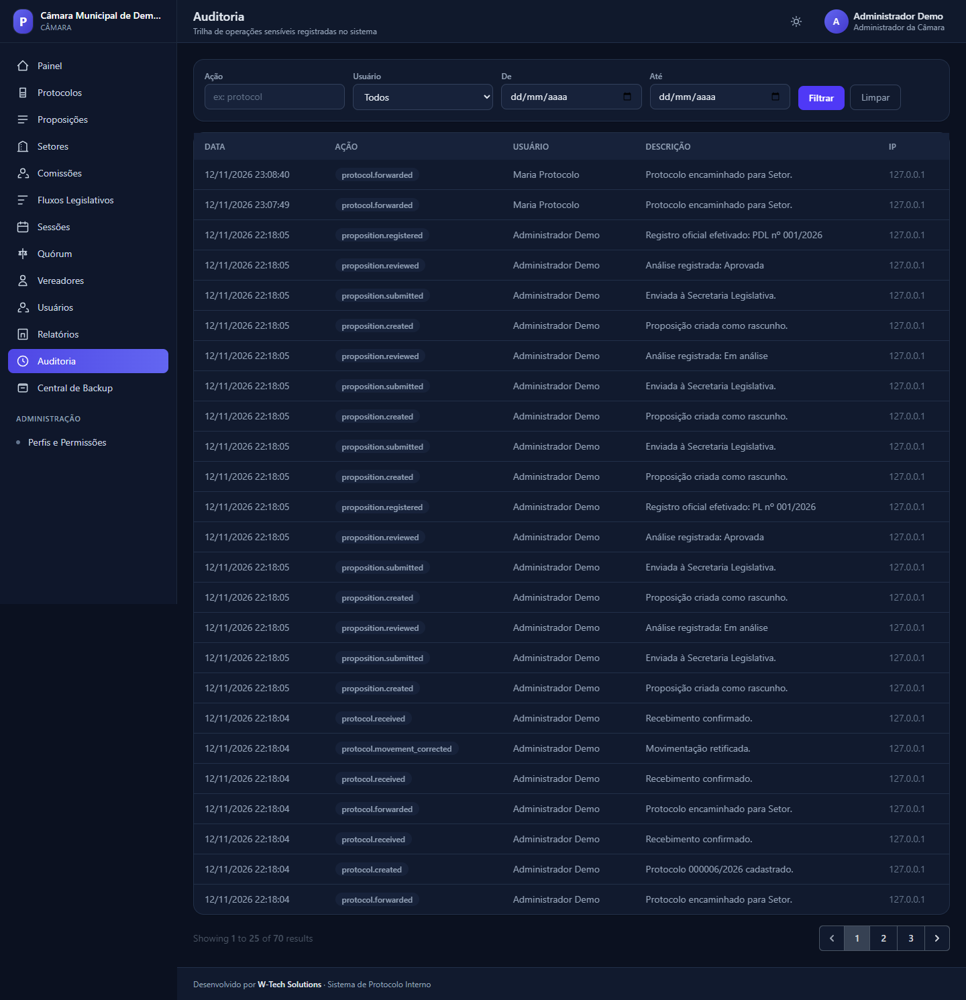

*Trilha de auditoria do sistema.*

### Central de Backup

Geração e restauração de cópias de segurança da Câmara.

- Backups podem ser **manuais** ou **automáticos** (agendados).
- Cada pacote contém banco de dados, anexos, um **manifesto** e **hash SHA-256** para conferência de integridade (e criptografia, quando habilitada).
- A **restauração** exige a confirmação do estado atual antes de sobrescrever os dados: o sistema **gera automaticamente um snapshot** de segurança antes de prosseguir.
- A retenção (por dias ou por quantidade) é configurável, e a restauração também pode ser feita a partir de um arquivo enviado.

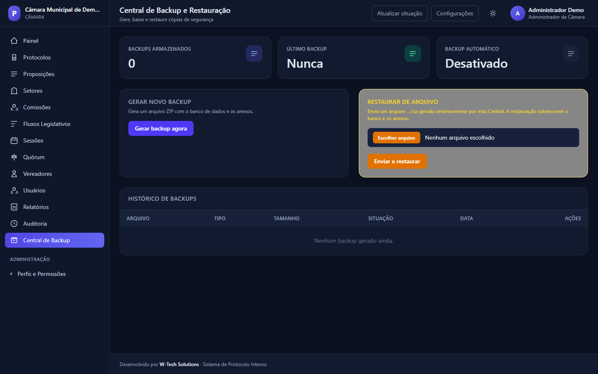

*Central de Backup: geração, download e restauração.*

---

## 14. Painel do Vereador

Quem tem vínculo com um vereador (perfil *Vereador* ou campo *Vereador vinculado*) vê o botão **Painel do Vereador** no rodapé do menu. Nele, o parlamentar acompanha:

- Suas **proposições**;
- Suas **comissões** e pendências;
- Suas **sessões** e **votações**.

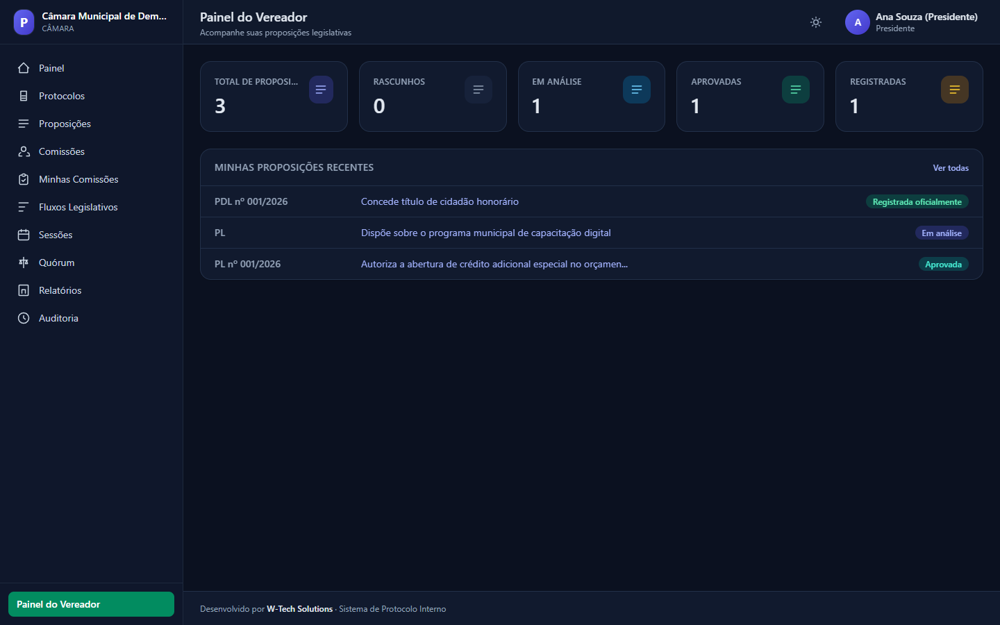

*Painel do Vereador, acessível a quem tem vínculo com um vereador (inclusive o Presidente vinculado).*

---

## 15. Perguntas frequentes

**Não consigo entrar com meu e-mail e senha.**
Verifique se o usuário está **Ativo**. Se estiver bloqueado, peça ao administrador para desbloquear.

**Não vejo um módulo no menu.**
O menu exibe apenas o que o **seu perfil** permite. Se você precisa de acesso, solicite ao administrador a troca de perfil.

**Recebi um "Acesso negado" (403).**
Seu perfil não tem permissão para aquela ação. Fale com o administrador.

**Como um vereador passa a atuar em uma comissão?**
Pelo **vínculo do usuário com o vereador** (seção [6.3](#63-vincular-a-um-vereador-opcional)) + a presença desse vereador na **composição ativa** da comissão. Não é necessária permissão administrativa.

**Posso ter dois usuários vinculados ao mesmo vereador?**
Não. O vínculo é 1 para 1: um novo vínculo substitui o anterior nos dois sentidos.

**O parecer de uma comissão já aprova a proposição?**
Não. O parecer é **consultivo**; a aprovação depende de **votação em Plenário**.

**Como entra no sistema um projeto de lei ou um veto enviado pelo Prefeito?**
Cadastre como **Proposição**, escolha **Origem = Poder Executivo** e informe o **autor externo** (ex.: "Prefeito Municipal"). Selecione a **Modalidade** adequada — **Projeto de Lei** ou **Veto**. A partir daí, o rito é o normal: comissões → parecer → pauta → votação em Plenário. Já os **ofícios** e comunicações que não são matéria legislativa entram pelo módulo **Protocolos**.

**Preciso cadastrar um vereador para registrar um projeto do Prefeito?**
Não. Ao escolher origem **Executivo** (ou **Outros**), o sistema pede apenas o **nome/cargo do autor externo**. O vínculo com vereador é exigido somente quando a origem é **Poder Legislativo**.

**Alterei a senha errada no cadastro.**
Edite o usuário e informe uma nova senha (com confirmação). Deixar o campo vazio mantém a senha atual.

**Perdi um documento ao recusar um recebimento?**
Não. A recusa devolve a responsabilidade e mantém todo o histórico registrado.

---

*Desenvolvido por **W-Tech Solutions**.*
